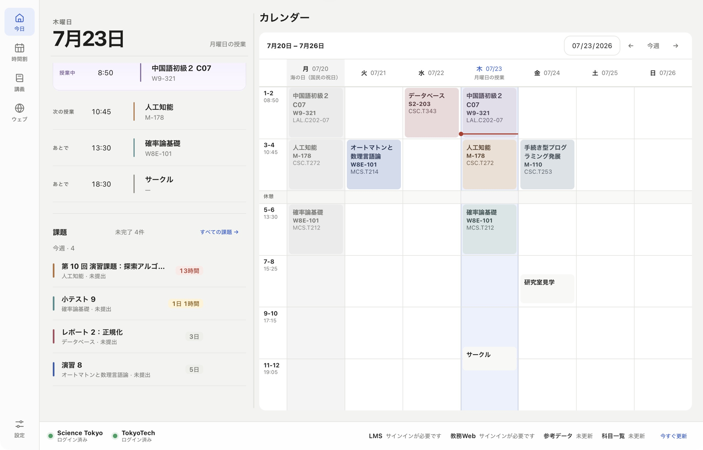
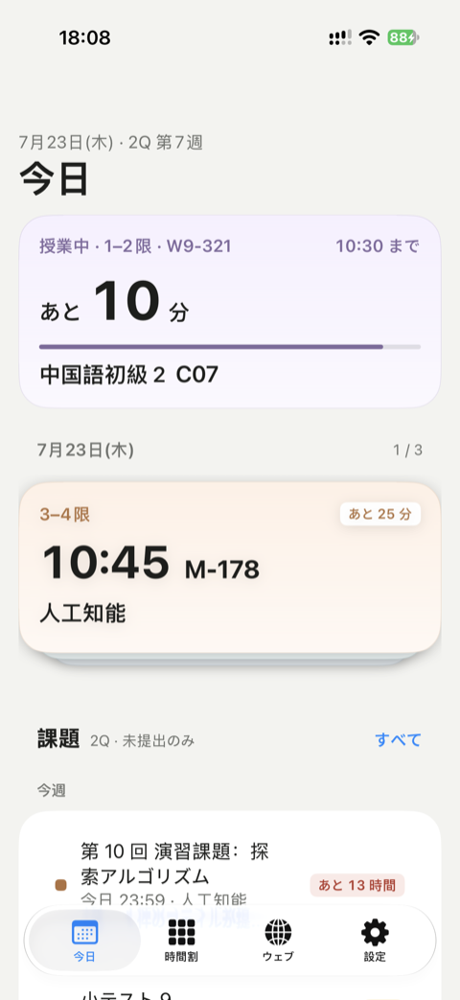

# IsctCompanion

**次の授業、どこだっけ。出す課題、あったっけ。**
**東京科学大学**（旧東京工業大学）の学生がつくった非公式アプリです。
時間割・教室・締切の課題・試験の日程を、T2SCHOLA（LMS）と教務Web から取り込んでひとつにまとめます。
サイトをいくつも開く必要はありません。

無料 · オープンソース · 広告なし · アカウント登録不要

**[isctcomp.app](https://isctcomp.app/)** ·
[ダウンロード](https://isctcomp.app/#download) ·
[試験と校暦](https://isctcomp.app/data/) ·
[不具合を報告](https://github.com/isct-companion/isct-companion/issues) ·
[開発に参加](CONTRIBUTING.md)

[English](README.md) · **日本語**

  
  

サンプルデータを入れた実際のアプリ画面です。

## 主な機能

- **Today：** 今日の授業と教室、締切が近い課題、LMS の新着を開いてすぐ確認。
- **時間割：** LMS の時間割をそのまま表示し、演習・実験のまとまりや教室も整理。自分の予定も同じ画面に。休講日や振替授業日は校暦どおり。
- **Lecture Desk：** 授業ごとに教材・課題・メモをまとめて扱えます。PDF はアプリ内で読め、ダウンロードした資料は授業別のフォルダに整理。
- **試験：** 公開された期末試験を履修中の授業と自動で照合し、試験期間中の補講も反映。見つからない試験は検索してひもづけるだけ。自分で直した日時や教室は更新後も残ります。
- **履修計画・成績・卒業要件：** 全科目を検索して時限ごとに候補を比較。教務Web から成績・GPA・取得単位を読み込み、卒業要件の進み具合を一覧。
- **通知：** 授業・試験・課題それぞれに自分のタイミングで。
- **ログインに時間をかけない：** マトリクス表はカメラで読み取るだけ。ワンタイムパスワードもアプリが登録し、ポータル・LMS・教務Web を入力なしで開けます。
- **端末をまたいで：** パソコンで整理、スマホでさっと確認。共有シートから PDF やリンクを取り込み、iPad ではドラッグ＆ドロップも。同期は自分のクラウドで。
- **AI エージェント連携：** Claude Code や Codex、Cursor から自分の時間割や課題をたずねられます（ローカル MCP サーバー）。

## ダウンロード

すべての版は[ダウンロードページ](https://isctcomp.app/#download)と
[GitHub Releases](https://github.com/isct-companion/isct-companion/releases/latest) にあります。

| 端末 | 動作環境 | 入手方法 |
| --- | --- | --- |
| macOS · Apple silicon / Intel | macOS 14 以降 | `.dmg`（Apple の署名・公証済み） |
| Windows · x64 | Windows 10 / 11 | `.exe` インストーラー（未署名のため **詳細情報 → 実行** を選択） |
| Android | Android 9 以降 | `.apk`（Google Play 版は準備中） |
| iPhone / iPad | iOS / iPadOS | [TestFlight 公開ベータ](https://testflight.apple.com/join/kUZNQHG6)（App Store 版は準備中） |

インストール後、設定で学内アカウントにサインインし、データを更新してください。

## プライバシー

- **サーバーもアカウントもなし。** データは端末の中に保存され、開発者に送られることはありません。
- **利用状況は集めません。** 利用統計やクラッシュレポートの自動送信も、広告もありません。
- **パスワードは OS が保管。** 学内アカウントやマトリクス表は、キーチェーンなど OS の保管庫にだけ保存します。マトリクス表はアプリに同梱した認識モデルで端末の中で読み取り、画像を外へ送りません。
- **同期は自分のクラウドで。** 端末間の同期には自分の iCloud や Google Drive を使います。

| 情報 | 取得元 |
| --- | --- |
| 授業・時間割・教材・課題・提出状況 | T2SCHOLA / LMS |
| 授業検索・履修登録・成績 | 教務Web |
| 授業の説明 | 東京科学大学シラバス |
| 試験・校暦・試験期間中の授業 | [Isct-Data](https://github.com/isct-companion/Isct-Data) |
| メモ・個人の予定・個人修正 | 自分の端末（SQLite） |

学内サイトへは端末から直接アクセスします。[Isct-Data](https://github.com/isct-companion/Isct-Data)
は大学が公開している日程を出典つきの JSON にまとめたもので、AI のワークフローが毎日公式ページを確認し、
スキーマ検証とテストを通ったものだけを公開します。最終的な日程は必ず大学の発表で確認してください。
詳しくは [データの所有関係](docs/data-ownership.md) を参照してください。

## しくみ

コアはひとつ、アプリは 3 つ。

| パス | 内容 |
| --- | --- |
| [`crates/app-core`](crates/app-core) | Rust コア：同期、学内サイトとの通信、時間割と試験のロジック、MCP サーバー |
| [`crates/adpt-isct`](crates/adpt-isct) | コアが使う Science Tokyo のページ解析・ページスクリプト・URL |
| [`crates/app-ocr`](crates/app-ocr) | 端末内で動くマトリクス表の読み取り |
| [`crates/app-ffi`](crates/app-ffi) | モバイルアプリ向け FFI |
| [`apps/desktop`](apps/desktop) | macOS・Windows 版（Tauri 2 · React） |
| [`apps/ios`](apps/ios) | iPhone・iPad 版（SwiftUI） |
| [`apps/android`](apps/android) | Android 版（Jetpack Compose） |

[開発ガイド](docs/development.md)から始めてください。[ドキュメント一覧](docs/README.md)に
ネイティブ SDK、データの保存先、[リリース手順](docs/desktop-release.md)をまとめています。

## 開発に参加

誰でも GitHub から参加できます。サークルへの加入や選考はありません。

- **不具合・提案：** [Issue](https://github.com/isct-companion/isct-companion/issues) へ。アプリのバージョン、OS、再現手順、期待した動作を書き、スクリーンショットのアカウント情報は隠してください。日本語で構いません。
- **コード：** 何を変えたか、どう確認したかを書いた Pull Request を送ってください。先に [CONTRIBUTING.md](CONTRIBUTING.md)（英語）と[テストガイド](apps/desktop/tests/README.md)を読んでください。
- **試験日程や校暦の誤り：** [Isct-Data の Issue](https://github.com/isct-companion/Isct-Data/issues) で教えてください。

AI の利用は禁止していません。ただし提出前に AI が書いた内容を読み、自分の言葉で変更を説明できるようにしてください。
AI を使ったかどうかは PR テンプレートに記入してください。

## ライセンス

IsctCompanion は大学とは関係のない独立したプロジェクトです。[GNU GPL v3 以降](LICENSE) と
[追加条項](docs/legal/NOTICE.ja.md)（[English](docs/legal/NOTICE.md)）の下で公開しています。
アプリストアでの配布を認め、改変版には別の名称を求めます。

## クレジット

コア開発者：[@Gliese129](https://github.com/Gliese129)、[@OHNope](https://github.com/OHNope)。
コントリビューター：Windows 版を実機で検証し、見つかった不具合を報告してくれた
[@ticofei-isct](https://github.com/ticofei-isct)。

IsctCompanion は学生が授業の合間に開発しています。役に立ったら、
[応援](https://isctcomp.app/sponsor/)をご検討ください。App Store の登録料や署名証明書などの費用にあてます。
