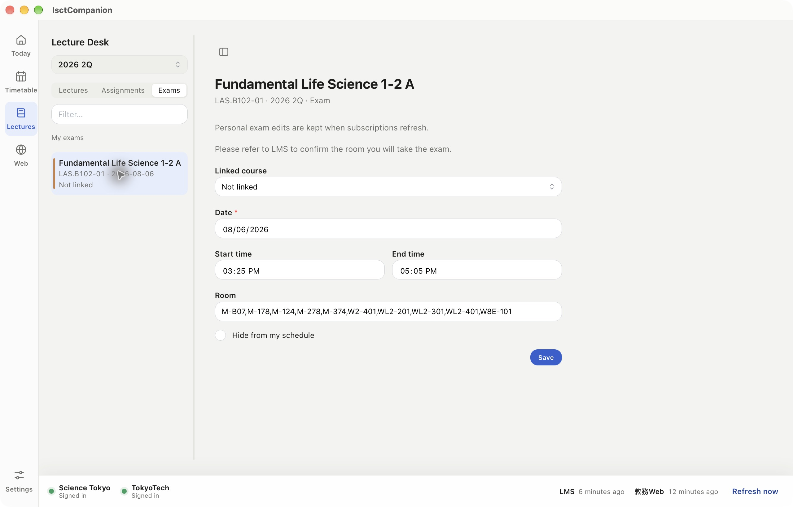
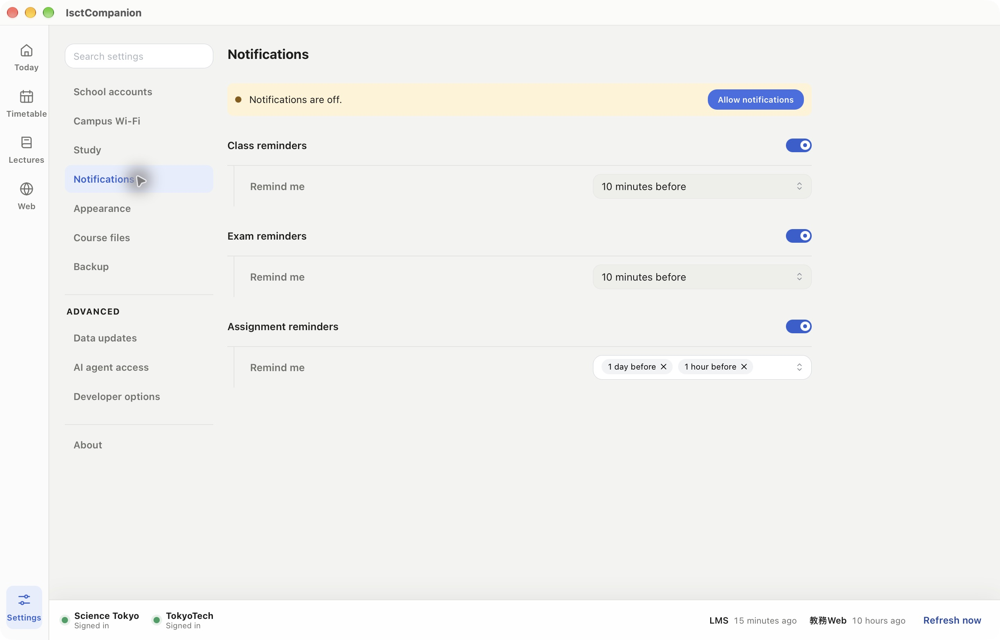

# IsctCompanion

A desktop companion for **Science Tokyo (東京科学大学・旧東京工業大学)**.
Bring your T2SCHOLA courses, timetable, assignments and exam schedules into one workspace on macOS and Windows.

**English** · [日本語](README.ja.md)

[Download the latest release](https://github.com/isct-companion/isct-companion/releases/latest) · [Report an issue](https://github.com/isct-companion/isct-companion/issues) · [Contribute](CONTRIBUTING.md) · [Documentation](docs/README.md)

## Your study day, in one place

- **Today:** daily classes, upcoming linked exams, assignment deadlines and completed work.
- **Lecture Desk:** browse courses by quarter, read LMS materials, track assignments and keep local notes.
- **Timetable:** browse current and historical LMS quarters alongside personal plans.
- **Exams:** see matched exams by quarter; search all published exams and edit or link a selected exam in the right pane.
- **Reminders:** configure classes, exams and assignments separately.
- **School portals:** open T2SCHOLA and 教務Web inside the app. Optional backups use your own cloud account.

## Install

Download an installer from [Releases](https://github.com/isct-companion/isct-companion/releases/latest):

| Platform | Download |
| --- | --- |
| macOS 14+ · Apple Silicon | `aarch64-apple-darwin.dmg` |
| macOS 14+ · Intel | `x86_64-apple-darwin.dmg` |
| Windows 10/11 · x64 | `x86_64-pc-windows-msvc.exe` |

macOS release installers are signed and notarized. Windows installers are currently unsigned.
Mobile interfaces are in development; desktop installers are available now.

On first launch, connect your school accounts in **Settings → School accounts**, then refresh school data.
Review matched exams under **Lectures → Exams** for the selected quarter; use Filter to search all published exams. A published exam enters your personal schedule when it matches or is linked to one of your courses.

## Data sources

| Information | Source |
| --- | --- |
| Courses, timetable, materials, assignments and submission status | T2SCHOLA / LMS |
| Course search, registration and official grades | 教務Web |
| Course descriptions and syllabus | Science Tokyo syllabus |
| Exams and academic reference dates | Configured reference-data subscriptions |
| Notes, plans and personal corrections | Local workspace |

Personal corrections survive source refreshes. Workspace data is stored locally in SQLite;
credentials stay in the operating system's credential vault. See [data ownership](docs/data-ownership.md).

## Development and contributions

Start with [CONTRIBUTING.md](CONTRIBUTING.md), the [development guide](docs/development.md)
and the [test guide](apps/desktop/tests/README.md). The [documentation index](docs/README.md)
links the Rust Core contract, native SDK, data imports and release workflow.

Maintainers can publish a reviewed version by pushing a matching version tag;
[release instructions](docs/desktop-release.md) cover signing, checks and review builds.

IsctCompanion is an independent project. Use and distribution are governed by the
[English EULA](docs/legal/EULA.md) and [日本語利用規約](docs/legal/EULA.ja.md).

## Acknowledgements

Thanks to [@ticofei-isct](https://github.com/ticofei-isct) for testing the
Windows app on real hardware and reporting the bugs found there.
