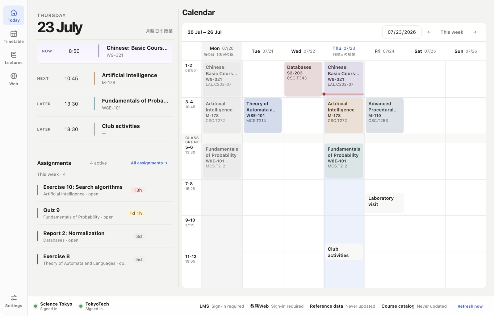
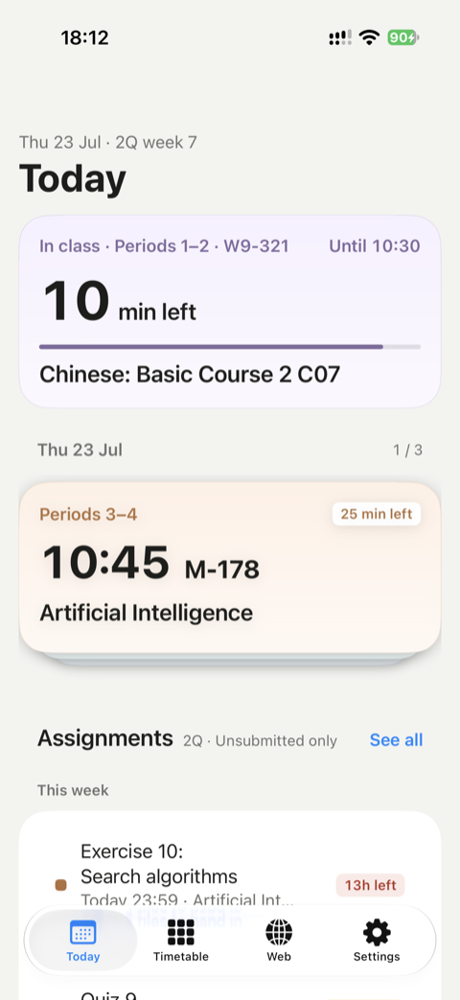

# IsctCompanion

**What class is next, and what's due?**
An unofficial app made by students of **Science Tokyo** (東京科学大学, formerly Tokyo Tech).
Your timetable, classrooms, assignments due and exam dates in one place, pulled
from T2SCHOLA (LMS) and 教務Web so you stop jumping between sites.

Free · Open source · No ads · No account

**[isctcomp.app](https://isctcomp.app/en/)** ·
[Download](https://isctcomp.app/en/#download) ·
[Exams & calendar](https://isctcomp.app/en/data/) ·
[Report an issue](https://github.com/isct-companion/isct-companion/issues) ·
[Contribute](CONTRIBUTING.md)

**English** · [日本語](README.ja.md)

  
  

Actual app screens with sample data.

## Features

- **Today:** today's classes and rooms, assignments due soon and what's new on LMS.
- **Timetable:** your LMS timetable with 演習・実験 groups and rooms sorted out,
  plus your own plans. Holidays and make-up days follow the academic calendar.
- **Lecture Desk:** materials, assignments and notes for each course together.
  Read PDFs in the app; downloads are filed into a folder per course.
- **Exams:** published finals matched to your courses, with make-up classes in
  exam week. Link unmatched exams yourself; your corrections survive every refresh.
- **Course planning, grades and requirements:** search courses and compare time
  slots, then check grades, GPA, credits and graduation progress from 教務Web.
- **Reminders:** separate timing for classes, exams and assignments.
- **Faster sign-in:** scan your Matrix card with the camera and the app registers
  the one-time password; the portal, LMS and 教務Web open already signed in.
- **Across devices:** organise on your laptop, check on your phone. Share a PDF or
  link into the app, drag files in on iPad, and sync through your own cloud.
- **AI agents:** ask Claude Code, Codex or Cursor about your timetable and
  assignments through a local MCP server.

## Download

Every build is on the [download page](https://isctcomp.app/en/#download) and on
[GitHub Releases](https://github.com/isct-companion/isct-companion/releases/latest).

| Device | Requires | Get it |
| --- | --- | --- |
| macOS · Apple silicon / Intel | macOS 14+ | `.dmg`, signed and notarized by Apple |
| Windows · x64 | Windows 10 / 11 | `.exe` installer (not signed yet: choose **More info → Run anyway**) |
| Android | Android 9+ | `.apk` (Google Play release on the way) |
| iPhone / iPad | iOS / iPadOS | [TestFlight public beta](https://testflight.apple.com/join/kUZNQHG6) (App Store release on the way) |

After installing, sign in to your school accounts in Settings and refresh.

## Privacy

- **No server, no account.** Your data lives on your device and is never sent to us.
- **No tracking.** No usage statistics, crash reports or ads.
- **Passwords kept by your OS.** School accounts and your Matrix card are stored
  only in the system vault, such as the Keychain. The Matrix card is read by a
  model bundled with the app; images never leave your device.
- **Sync through your own cloud.** Devices sync through your own iCloud or Google Drive.

| Information | Source |
| --- | --- |
| Courses, timetable, materials, assignments, submission status | T2SCHOLA / LMS |
| Course search, registration, grades | 教務Web |
| Course descriptions | Science Tokyo syllabus |
| Exams, academic calendar, exam-week classes | [Isct-Data](https://github.com/isct-companion/Isct-Data) |
| Notes, plans, personal corrections | Your device (SQLite) |

School sites are reached straight from your device. [Isct-Data](https://github.com/isct-companion/Isct-Data)
turns what the university publishes into JSON with sources cited; an AI workflow
checks the official pages daily, and nothing is published without passing schema
validation and tests. Always confirm the final schedule with the university.
See [data ownership](docs/data-ownership.md) for details.

## How it's built

One shared Rust core, three native apps.

| Path | What |
| --- | --- |
| [`crates/isct-core`](crates/isct-core) | Rust core: sync engine, school site access, timetable and exam logic, MCP server |
| [`crates/isct-ocr`](crates/isct-ocr) | On-device Matrix card reader |
| [`crates/isct-ffi`](crates/isct-ffi) | FFI bindings for the mobile apps |
| [`apps/desktop`](apps/desktop) | macOS and Windows app (Tauri 2 · React) |
| [`apps/ios`](apps/ios) | iPhone and iPad app (SwiftUI) |
| [`apps/android`](apps/android) | Android app (Jetpack Compose) |

Start with the [development guide](docs/development.md); the
[documentation index](docs/README.md) links the Core contract, native SDK, data
imports and [release workflow](docs/desktop-release.md).

## Contributing

Anyone can take part on GitHub; there is no club to join.

- **Bugs and ideas:** open an [issue](https://github.com/isct-companion/isct-companion/issues)
  with the app version, your OS, steps to reproduce and what you expected.
  Hide account details in screenshots. Japanese is fine.
- **Code:** send a pull request that says what changed and how you checked it.
  Read [CONTRIBUTING.md](CONTRIBUTING.md) and the [test guide](apps/desktop/tests/README.md) first.
- **Wrong exam date or calendar entry:** open an issue on
  [Isct-Data](https://github.com/isct-companion/Isct-Data/issues).

AI help is welcome, but read what it wrote before you submit and be ready to
explain the change in your own words. Note in the PR template whether AI assisted you.

## License

IsctCompanion is an independent project, not affiliated with the university.
It is licensed under the [GNU GPL v3 or later](LICENSE) with the additional terms in
[docs/legal/NOTICE.md](docs/legal/NOTICE.md) ([日本語](docs/legal/NOTICE.ja.md)):
app-store distribution is allowed, and modified versions must use another name.

## Credits

Core developers: [@Gliese129](https://github.com/Gliese129), [@OHNope](https://github.com/OHNope).
Contributors: [@ticofei-isct](https://github.com/ticofei-isct), who tested the
Windows app on real hardware and reported the bugs found there.

IsctCompanion is built by students between classes. If it helps you, consider
[supporting the project](https://isctcomp.app/en/sponsor/): it pays for things
like the App Store fee and a code-signing certificate.
