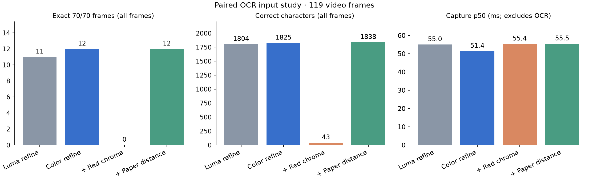
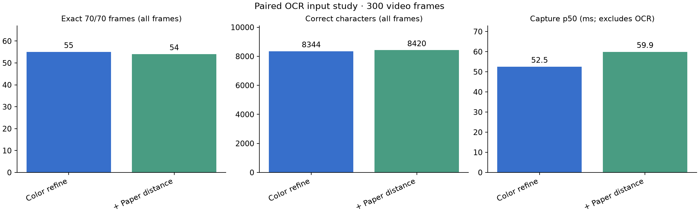

# Matrix 定位与色差输入实验（2026-10-23）

默认采用长边 640 像素粗定位、上一帧范围内搜索、八条颜色分界精修，再从原图机械切格。颜色不足时回退亮度精修。模型默认保持 Rec.601 灰度；纸张色差和纯红色色差作为可复现的输入对照保留。

原先每个候选都旋转整张高分辨率图像，候选多时重复成本很高。现在只采样候选附近的有界小块，精修密度最多为每行 40 像素；上一帧只限定搜索范围，每帧仍重新测量当前边界，失败时恢复全图搜索。Core 继续拥有会话、投票和调度状态。

## 方法

使用同一段约 59.49 秒的本地视频。第一组按 2 fps 抽取 119 帧，第二组取 26–36 秒按 30 fps 抽取 300 帧，两组都把长边缩放为 2200 像素。第二组与第一组来自同一视频，不构成独立验证集。按时间顺序处理，上一帧检测结果用于缩小下一帧搜索范围；所有变体串行执行。

模型权重保持不变，使用现有 10 格微批接口。三种模型输入共享完全相同的切格坐标，脚本逐帧检查坐标一致性。质量评分全部来自原始亮度，避免背景归一化改变反光、纹理与清晰度评分。

- **灰度**：与训练一致的 Rec.601 亮度。
- **纯红色色差**：`R − (G+B)/2`，按每格纸张的色差信号归一化。黑字和白纸的此信号都接近零，因此会丢失白色行的文字信息。
- **纸张色差**：取每格内部 RGB 各通道的上四分位数为纸张颜色 `b`，输出 `255 × (1 − ‖max(b−p, 0)‖₂ / ‖b‖₂)` 并截断到 0–255。纸张接近白、黑字接近黑，再进入原有字符归一化和模型。

这是逐帧模型输出对照。定位失败记零，整帧正确要求 70 格文字全部匹配；未应用 Core 多帧投票、质量准入或截止时间，因此不能把这些比例当作 6–7 秒会话成功率。高置信度错误指非空错误字符且置信度 ≥0.8，也不是最终会话错误放行数。

## 119 帧结果

| 精修 / 模型输入 | 检出帧 | 正确字符 / 8330 | 全对帧 / 119 | 高置信度错误 | 采集处理 p50 / p95 ms |
|---|---:|---:|---:|---:|---:|
| 亮度精修 / 灰度 | 44 | 1804 | 11 | 74 | 55.0 / 79.6 |
| 颜色精修 / 灰度 | 44 | 1825 | 12 | 75 | 51.4 / 76.3 |
| 颜色精修 / 纯红色色差 | 44 | 43 | 0 | 109 | 55.4 / 82.3 |
| 颜色精修 / 纸张色差 | 44 | 1838 | 12 | 96 | 55.5 / 82.7 |



旧版全分辨率定位在同一组帧的早前单独运行中，检出 41 帧、10 帧全对，采集处理 p50 为 341.9 ms。新版默认为 51.4 ms；两次运行的系统负载未锁定，此比较用于判断主要耗时量级。采集处理包括解码、定位、70 格裁图和质量评分，不含 OCR；新版默认全 70 格 OCR 的 p50 约 103.9 ms，生产管线可与下一帧采集重叠。

## 连续 300 帧复核

| 模型输入（相同颜色精修） | 检出帧 | 正确字符 / 21000 | 全对帧 / 300 | 高置信度错误 | 采集处理 p50 / p95 ms |
|---|---:|---:|---:|---:|---:|
| 灰度 | 177 | 8344 | 55 | 255 | 52.5 / 76.8 |
| 纸张色差 | 177 | 8420 | 54 | 355 | 59.9 / 84.1 |



纸张色差增加了正确字符，但整帧正确数没有改善，高置信度错误增加。因此保留灰度为默认模型输入。颜色信息已用于定位精修；模型输入变换仍可用脚本继续验证。当前检出率与错误帧表明，仍需完善定位和真实扫描验证，尚未达到 95% 会话成功率的验收结论。

## 复现

在本地准备有序 JPEG/PNG 帧目录和仅含 70 个 A–Z 字符的真值文件；换行可保留。运行环境需 Rust、NumPy 和 Matplotlib。

```sh
python scripts/ocr/matrix_locator_study.py \
  --frames /path/to/local/frames \
  --expected /path/to/local/expected.txt \
  --out /path/to/local/results
```

连续帧复核可加 `--variants color-refinement paper-distance-input`。`--target` 可指定已有 Cargo 构建缓存。脚本编译并调用生产 Rust 采集与模型代码，输出逐帧 JSONL、汇总 JSON 和图；图像、真值和逐帧输出均保留本地，本目录只保存汇总指标。

真实 App 的移动跟随、Q 尾部和冷暖光验收使用 `OCR-CAMPUS-CARD`。离线处理耗时不包括摄像头、WebView 桥接与画框延迟。

## 验证与代码变化

OCR 测试 21 项通过，4 项依赖私有素材的既有测试按标记忽略；OCR 库及 benchmark 的 clippy（`-D warnings`）通过；禁用 OCR 后端的接口编译通过。桌面前端与 Rust 原生构建通过，生成的 `1.1.7-dev` App 已校验版本和 ad-hoc 签名。真实相机验收项仍为 `OCR-CAMPUS-CARD`。

生产代码新增 657 行、删除 90 行，净增 567 行；测试净增 135 行，扩展现有采集与定位用例并新增颜色分界测试，未删除既有测试；实验工具新增 219 行。生成的汇总数据为 120 行 JSON 和两张 PNG，另计于生产与测试代码之外。
